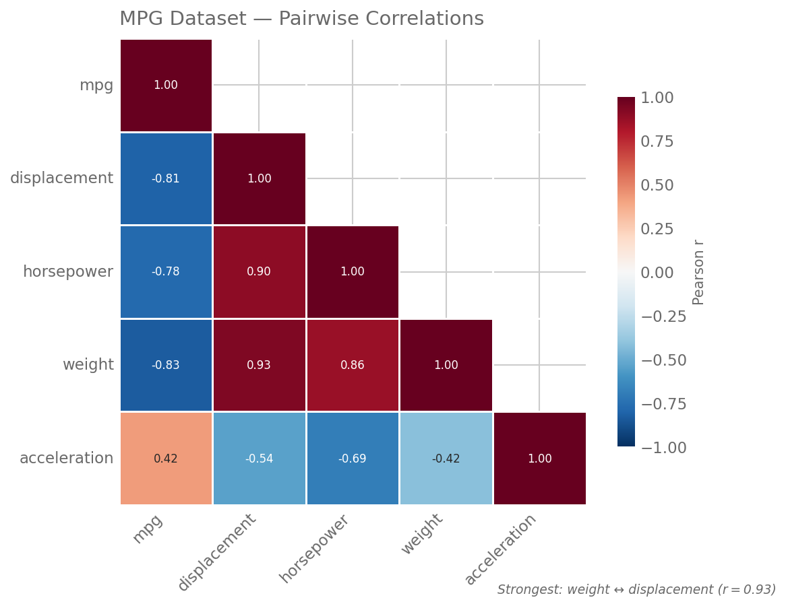

# matplotlib -- Claude Code Skill

Publication-quality matplotlib/seaborn charts with an opinionated aesthetic. Colorblind-accessible, despined, annotation-rich figures using DejaVu Sans, cubehelix/ColorBrewer palettes, and whitegrid styling.

<p align="center">
  
  
  
</p>

## Install

### Plugin Marketplace

```
/plugin marketplace add tvhahn/matplotlib-skill
```

### Manual (auto-discovered by Claude Code)

```bash
git clone https://github.com/tvhahn/matplotlib-skill.git
cd matplotlib-skill
# Claude Code auto-discovers .claude/skills/matplotlib/SKILL.md in any repo clone
```

### Global Install (available in all projects)

```bash
# Symlink so the skill is available everywhere
ln -s /path/to/matplotlib-skill/.claude/skills/matplotlib ~/.claude/skills/matplotlib
```

### Lightweight Clone (skill only, ~3 MB)

```bash
git clone --depth 1 https://github.com/tvhahn/matplotlib-skill.git
```

## What It Does

9 chart patterns, each with an opinionated template:

| Pattern | Name | When to use |
|---------|------|-------------|
| P1 | Horizontal Bar | Ranked percentages, category comparisons |
| P2 | Vertical Bar | Comparisons across categories, ranked values |
| P3 | Time Series | Time series with rolling average |
| P4 | Violin + Strip | Distribution comparisons |
| P5 | Lollipop | Min/max/avg ranges, model comparison |
| P6 | Decision Boundary | Classification boundaries, probability maps |
| P7 | Heatmap | Correlation matrices, spectrograms |
| P8 | Multi-Panel | Multi-panel grid layouts (2x2, 3x2, 3x3) |
| P9 | PR/ROC | PR/ROC classification evaluation curves |

## Design Philosophy

1. Above all else, show the data
2. Every element earns its ink
3. Prefer position over color, color over size
4. Grey is a color. White space is a feature.
5. Despine, degrid, then add back only what the reader needs
6. Annotate the insight, not just the axis
7. Encode meaning twice -- never rely on color alone
8. Consistency across panels; variety across charts
9. The reader should never do arithmetic
10. When in doubt, remove

## Datasets

Ships with 39 datasets for testing and demos:
- **10 source project datasets** from Tim's research (bearing RUL predictions, arxiv paper labels, classifier comparisons, tool wear)
- **29 public reference datasets** (penguins, gapminder, tips, iris, titanic, and more)

See [`data/datasets.yaml`](data/datasets.yaml) for the full manifest with attribution, licenses, and pattern mappings.

## How This Skill Was Built

This skill was developed iteratively across 50+ iterations. Key milestone entries are in [`docs/gallery/`](docs/gallery/). The full 51-entry development history is in the local `gallery-archive/` folder (git-excluded).

See [`docs/blog/`](docs/blog/) for the blog post about the process.

## Verification

```bash
# Generate charts in a Docker clean room (Docker required)
scripts/chart-test-container.sh --quick            # 5 prompts, random from pools
scripts/chart-test-container.sh                    # all 9 prompts, random from pools
scripts/chart-test-container.sh --fixed            # all 9 prompts, original defaults

# Static analysis (fast, no Docker)
uv run scripts/evaluate_skill.py --check-renders
```

## Contributing

See [CONTRIBUTING.md](CONTRIBUTING.md) for guidelines on modifying patterns, adding new ones, and running tests.

## License

[MIT](LICENSE)
