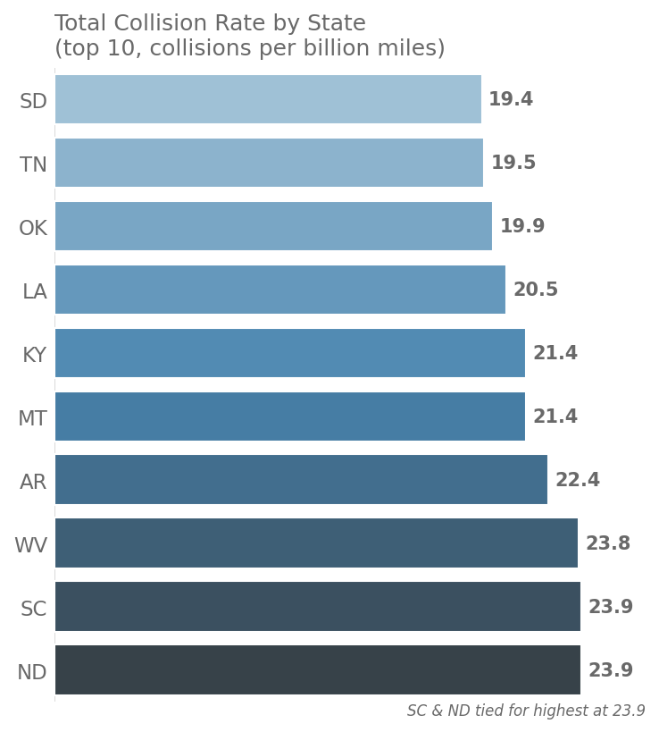
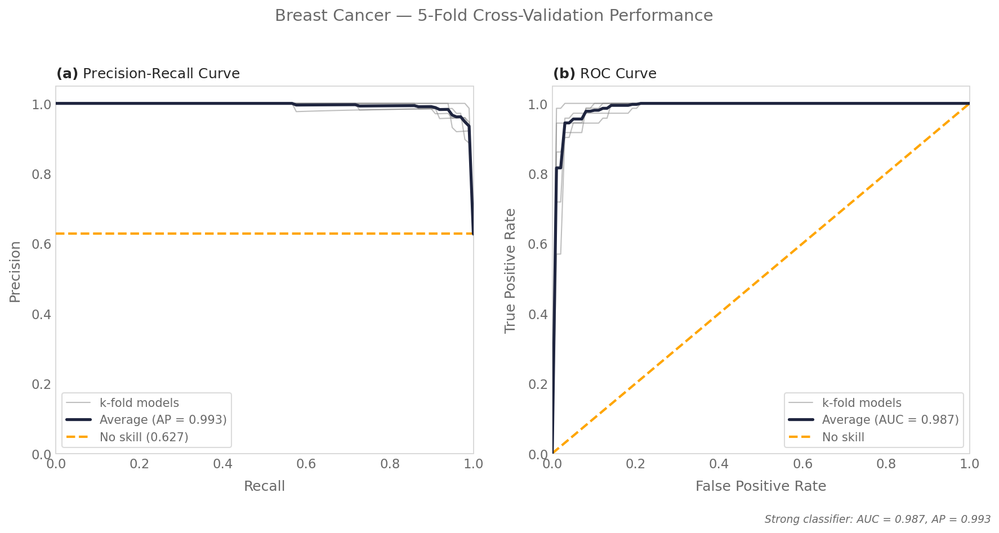
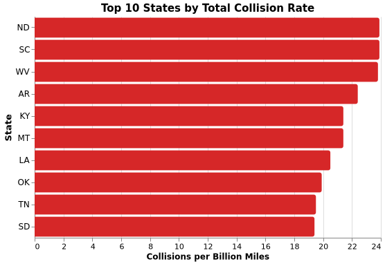
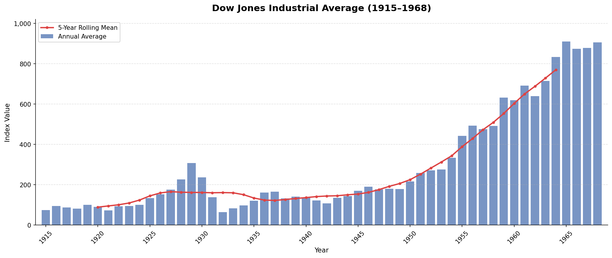
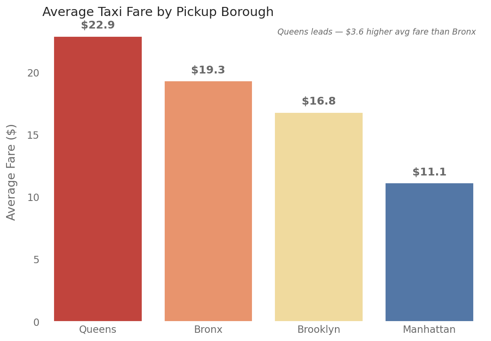
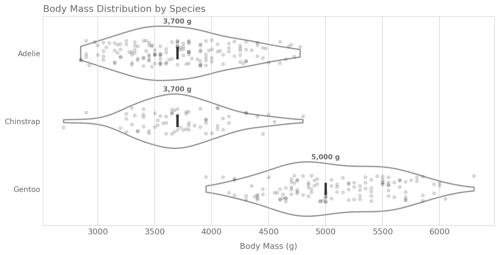
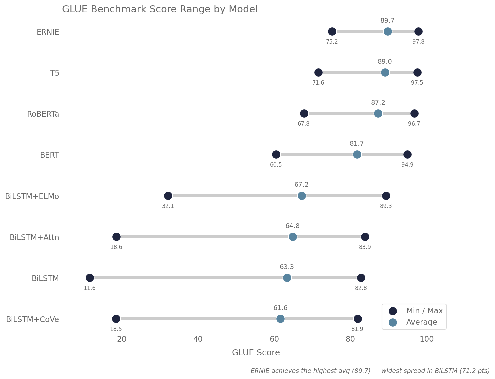
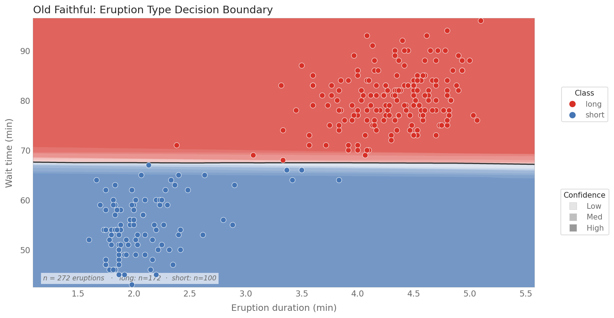
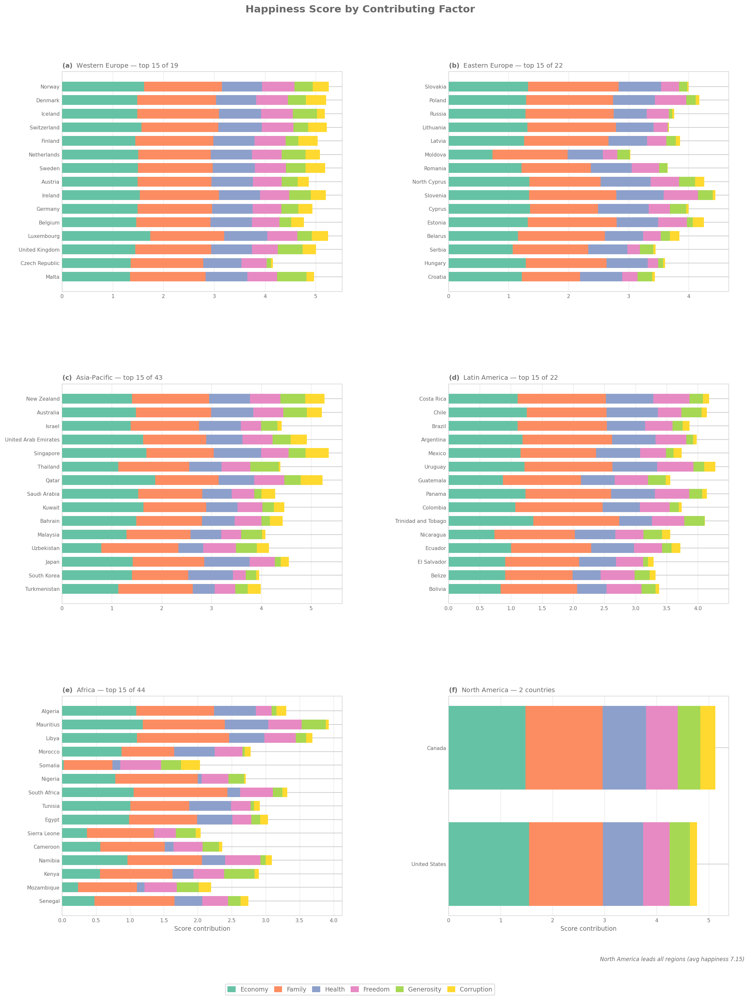

# matplotlib -- Claude Code Skill

Publication-quality matplotlib/seaborn charts from a one-line prompt. Colorblind-accessible, despined, annotation-rich figures using DejaVu Sans, cubehelix/ColorBrewer palettes, and whitegrid styling. Opinionated.

<table>
<tr>
<td></td>
<td></td>
<td></td>
</tr>
</table>

## Usage

```
> make a chart of collision rates by state using the matplotlib skill
```

The skill picks the chart type, applies opinionated templates and palettes, and saves PDF+PNG to `./figures/`.

## Before vs. After

Same data. Same prompt. The skill applies despined axes, cubehelix palettes, value labels, and insight annotations.

<table>
<tr>
<th width="50%">Claude defaults</th>
<th width="50%">With skill</th>
</tr>
<tr>
<td></td>
<td></td>
</tr>
</table>

<details>
<summary>More comparisons</summary>

<table>
<tr>
<th width="50%">Claude defaults</th>
<th width="50%">With skill</th>
</tr>
<tr>
<td></td>
<td></td>
</tr>
<tr>
<td></td>
<td></td>
</tr>
</table>

</details>

## Install

### Clone (auto-discovered by Claude Code)

```bash
git clone https://github.com/tvhahn/matplotlib-skill.git
cd matplotlib-skill
# Claude Code auto-discovers .claude/skills/matplotlib/SKILL.md in any repo clone
```

### Global install (available in all projects)

```bash
ln -s /path/to/matplotlib-skill/.claude/skills/matplotlib ~/.claude/skills/matplotlib
```

## 9 Chart Patterns

<table>
<tr>
<td align="center"><br/><b>P1</b> Horizontal Bar</td>
<td align="center"><br/><b>P2</b> Vertical Bar</td>
<td align="center"><br/><b>P3</b> Time Series</td>
</tr>
<tr>
<td align="center"><br/><b>P4</b> Violin + Strip</td>
<td align="center"><br/><b>P5</b> Lollipop</td>
<td align="center"><br/><b>P6</b> Decision Boundary</td>
</tr>
<tr>
<td align="center"><br/><b>P7</b> Heatmap</td>
<td align="center"><br/><b>P8</b> Multi-Panel</td>
<td align="center"><br/><b>P9</b> PR/ROC</td>
</tr>
</table>

| Pattern | When to use |
|---------|-------------|
| P1 Horizontal Bar | Ranked percentages, category comparisons |
| P2 Vertical Bar | Comparisons across categories, ranked values |
| P3 Time Series | Time series with rolling average |
| P4 Violin + Strip | Distribution comparisons |
| P5 Lollipop | Min/max/avg ranges, model comparison |
| P6 Decision Boundary | Classification boundaries, probability maps |
| P7 Heatmap | Correlation matrices, spectrograms |
| P8 Multi-Panel | Multi-panel grid layouts (2x2, 3x2, 3x3) |
| P9 PR/ROC | PR/ROC classification evaluation curves |

## Design Philosophy

> *Above all else, show the data. Annotate the insight, not just the axis. When in doubt, remove.*

<details>
<summary>Full principles</summary>

1. Above all else, show the data
2. Every element earns its ink
3. Prefer position over color, color over size
4. Grey is a color. White space is a feature.
5. Despine, degrid, then add back only what the reader needs
6. Annotate the insight, not just the axis
7. Encode meaning twice -- never rely on color alone
8. Consistency across panels; variety across charts
9. The reader should never do arithmetic
10. When in doubt, remove

</details>

## How This Skill Was Built

Built through 50 iterations of automated evaluation -- an AI refining its own visual taste. [Read the story &rarr;](docs/blog/building-a-claude-code-skill.md)

## Datasets

Ships with 39 datasets for testing and demos:
- **10 source project datasets** from Tim's research (bearing RUL predictions, arxiv paper labels, classifier comparisons, tool wear)
- **29 public reference datasets** (penguins, gapminder, tips, iris, titanic, and more)

See [`data/datasets.yaml`](data/datasets.yaml) for the full manifest with attribution, licenses, and pattern mappings.

## Verification

```bash
# Generate charts in a Docker clean room (Docker required)
scripts/chart-test-container.sh --quick            # 5 prompts, random from pools
scripts/chart-test-container.sh                    # all 9 prompts, random from pools
scripts/chart-test-container.sh --fixed            # all 9 prompts, original defaults

# Static analysis (fast, no Docker)
uv run scripts/evaluate_skill.py --check-renders
```

## Contributing

See [CONTRIBUTING.md](CONTRIBUTING.md) for guidelines on modifying patterns, adding new ones, and running tests.

## License

[MIT](LICENSE)
