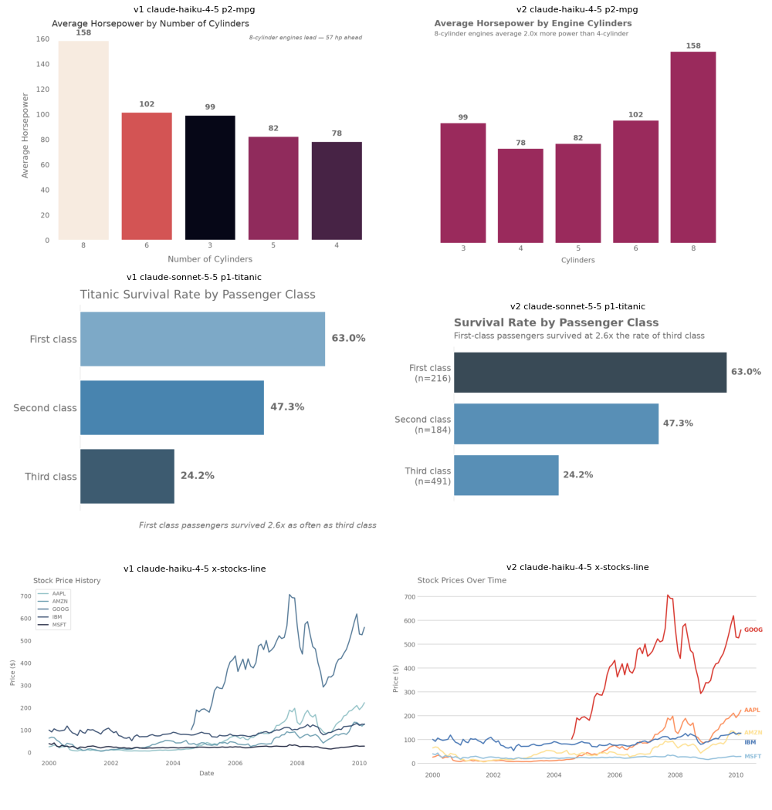

# Skill v2 Benchmark — October 2026

The skill was last tuned in March 2026 against older models. This benchmark asks
whether it still helps the current models (Opus 5.5, Sonnet 5.5, Haiku 4.5), what it
gets wrong, and whether a revision (v2) built on the
[Agent Skills best practices](https://platform.claude.com/docs/en/agents-and-tools/agent-skills/best-practices)
is better.

*Left: v1. Right: v2. Top: ordinal axis kept in natural order instead of value-sorted
with a near-white lead bar. Middle: takeaway as a subtitle and the leader highlighted,
instead of a decorative gradient and a corner footer. Bottom: distinct hues with direct
labels instead of five shades of one blue.*

## Setup

- **Harness:** `scripts/benchmark.py` — headless `claude -p` in clean rooms outside the
  repo (Claude Code discovers skills in ancestor directories, so a room under the repo
  sees the repo's own skill). Bundled and user skills disabled. No Docker needed.
- **Prompts:** `scripts/benchmark_prompts.yaml` — 8 pattern prompts (P1–P5, P7–P9) and
  4 off-pattern prompts (line, scatter, histogram, grouped comparison), each with
  ground-truth checks.
- **Conditions:** v1 (skill at `ec4a4b4`) and v2 × 3 models × 12 prompts; Sonnet 5.5
  without any skill as a control.
- **Scoring:** `check_figure.py` on every generated script; vision-model judges with
  `scripts/judge_rubric.md` (absolute, 1–10); **blind pairwise** v1-vs-v2 judges with
  randomised A/B and a neutral prompt. Raw judgements are in `judgements/`.

## Results

**Blind pairwise, v2 vs v1** (same model, same prompt):

| Model | v2 wins | v1 wins | Ties |
|---|---|---|---|
| Haiku 4.5 | 12 | 0 | 0 |
| Sonnet 5.5 | 11 | 0 | 1 |
| Opus 5.5 | 9 | 3 | 0 |
| **Total** | **32** | **3** | **1** |

**Absolute judge score (mean of 12, out of 10):**

| Model | No skill | v1 | v2 |
|---|---|---|---|
| Haiku 4.5 | — | 5.0 | **7.1** |
| Sonnet 5.5 | 5.8 | 6.9 | **7.8** |
| Opus 5.5 | — | 7.4 | **7.8** |

**Process metrics:**

| | v1 | v2 |
|---|---|---|
| Runs that produced a chart | 35/36 | 36/36 |
| Runs that ran the layout checker | 1/36 | 36/36 |
| Final charts with a checker ERROR | 2 | 0 |
| Off-pattern prompts routed to a sensible pattern | 3 runs read P3 (bars) or P6 (decision boundary) for a line/scatter | 12/12 → `other-charts.md` |
| Cost per chart — Opus / Sonnet / Haiku | $0.37 / $0.18 / $0.11 | $0.29 / $0.16 / $0.12 |
| Skill tokens loaded per invocation | ~6.7k | ~5.4k |

No-skill Sonnet costs $0.05 per chart and takes 11 s, but left **no reproducible
script in 10 of 12 runs** (it plotted from inline `python -c`), never looked at its own
output, and kept the default matplotlib look.

## What was wrong with v1

Ordered by impact on output:

1. **Takeaways exiled to a corner footer.** Templates put the "insight" in an italic
   `fig.text(0.98, 0.01, …)` line. Judges flagged it in 9 of 12 charts per model; it
   often restated a printed bar value, and in the heatmap it crowded the tick labels.
   Tim's own original lollipop states the takeaway as a subtitle under the title — v2
   uses that.
2. **Colour used decoratively or wrongly.** `Blues_d`/`rocket` gradients repeated bar
   length; sequential palettes (cubehelix) were used for unordered categories (stocks,
   continents), making series indistinguishable.
3. **P2's "sort descending" Signature scrambled ordinal axes** (cylinders 8-6-3-5-4).
4. **No home for common charts.** With no line/scatter/histogram pattern, models read
   P3 ("always use `ax.bar()`") for a line chart and P6 (decision boundary) for a scatter.
5. **Correctness bug in an invariant.** "Apply `df.dropna()` after loading" drops any
   row missing *any* column. On Titanic it changes 3rd-class survival from 24% to 50%.
   All 5.5-era models silently scoped it to the plotted columns, so it did not bite in
   this benchmark — but the instruction was wrong.
6. **Template bugs.** P9's `float(data["baseline"])` raises on current NumPy for every
   dataset; P4 positioned median labels by `unique()` order rather than the plot's order.
7. **Visual-only verification.** Small collisions are hard to see in a downsized PNG;
   only 1 of 36 runs did any programmatic check.
8. **Best-practice gaps.** Contradictory guidance (P7 colorbar label, P4 orientation),
   heavy CRITICAL/MUST/ALWAYS language that makes newer models rigid, no table of
   contents in long reference files, `Edit` missing from `allowed-tools`, a description
   that over-triggers on "diagram" and under-triggers on terse requests.

## What changed in v2

- `scripts/check_figure.py`: runs a chart script and reports text collisions (including
  rotated labels), legends/labels on data, annotations spilling across panels, empty
  panels, tiny text, and style drift. Wired into the workflow as step 5.
- SKILL.md rewritten as a copyable 7-step checklist; data-handling rules (scoped
  `dropna`, natural category order); description rewritten in third person with explicit
  triggers.
- `patterns/other-charts.md`: line, scatter, histogram, grouped bar.
- Title + computed subtitle replaces corner footers; annotations placed at the data.
- Palette selection table (what colour encodes → which palette) and an ordered
  `CATEGORICAL` list.
- All 14 template blocks run on real data and pass the checker (`tests/test_patterns.py`).

A follow-up (v2.1, included in this commit) fixed three issues the v2 judges raised:
WARNs are now resolved rather than optional, the categorical palette is reordered so the
first three hues are maximally distinct (won both blind scatter comparisons), and the
description handles terse "chart + file" prompts (Haiku P9: 3/3 after vs 1/3 before).

## Remaining weaknesses (from the v2 judges)

- Insight is usually a subtitle; the best charts *also* annotate at the data (P3, histogram).
- Value labels still land on dense strip points (P4) and spaghetti lines (P8).
- Opus's legibility score dipped slightly (2.58 → 2.33): it adds more callouts, and some collide.
- The P9 orange baseline reads as off-palette to judges. It is Tim's original choice, so it stays.

## Caveats

- 12 prompts × 1 run per cell; single-run variance is real (Haiku P9 flipped between runs).
- The absolute rubric penalises detached footers, which v2 removes by design — that is
  why the blind pairwise comparison, with a neutral prompt, is the headline result.
- Judges are Claude models; no human rating.
