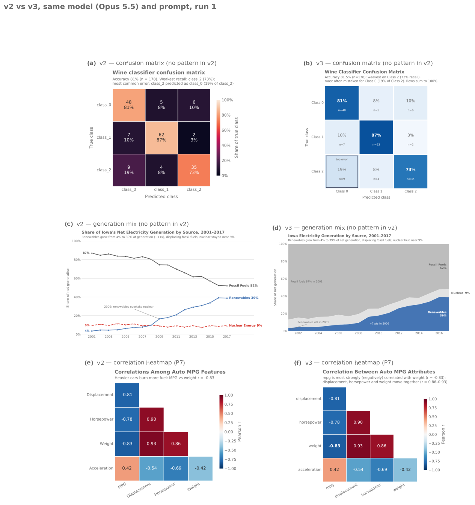
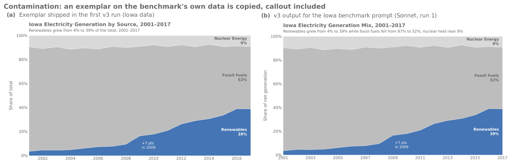

# Skill v3 Benchmark — October 2026

v3 adds exemplar images, an independent reviewer subagent, a chart-choice router with
four new patterns (P10–P13), a craft layer adapted from Rougier's *Scientific
Visualization*, and a much stricter checker (proposal:
[`docs/idea-garden/2026-10-v3-roadmap.md`](../../idea-garden/2026-10-v3-roadmap.md)).
This benchmark asks whether v3 beats v2 on the same prompts, models and judges.

*Left: v2. Right: v3. Same model (Opus 5.5), same prompt, run 1. Top two: chart types
v2 had no pattern for. Bottom: an existing pattern.*

## Headline

- **v3 wins blind pairwise judging against v2.** On the original 12 prompts it wins
  56–58% of all pairs (67–71% of pairs that weren't tied); over all 23 prompts, 62–63%
  of all pairs (73–77% of decided). Each pair is judged in both A/B orders by two
  judges, and an order disagreement counts as a tie. The gain is largest on the new
  chart types (84–85% of decided) and smallest off-pattern (55–60%).
- **Every run now routes to the right pattern** (205/207, against 145/207 for v2), and
  the checker findings left on final charts fell from 64 to 5, of which 2 are real.
- **Measured costs:** v3 runs cost 1.7× as much and take 1.9× as long, mostly because of
  the reviewer. Haiku's repeated runs became markedly *more* uniform. Absolute scores
  rose but missed the targets set in the roadmap.
- **The first v3 run was contaminated** and is not used here (see below).

## Setup

- **Harness:** `scripts/benchmark.py` — headless `claude -p` in clean rooms outside the
  repo. Changed since the v2 write-up: child runs get an explicit tool allowlist
  instead of bypassing permissions, and every cell runs 3 times. Because of that, v2
  was **re-run** under the same harness (`logs/bench/v2base`, skill at `d2c1682`); the
  v2 numbers here are not comparable with the October v2 README.
- **Prompts:** 23 in `scripts/benchmark_prompts.yaml`:
  - 9 `pattern`: P1–P9
  - 4 `offpattern`: line, scatter, histogram, grouped
  - 3 `mode`: publication, quick, function
  - 7 `newchart`: slope, dumbbell, generation mix, ECDF, ridgeline, training curves,
    confusion matrix
- **Runs:** 3 models (Opus 5.5, Sonnet 5.5, Haiku 4.5) × 23 prompts × 3 runs = 207 per
  version.
- **Judges:** `scripts/judge.py`. Opus 5.5 and Sonnet 5.5 judge headlessly; each judge
  sees only the PNG(s), the request with its ground-truth checks, and the rubric —
  never the code, model or version.
  - **Pairwise:** each pair is judged in both A/B orders. When the two orders disagree,
    the pair counts as a tie.
  - **Absolute:** `scripts/judge_rubric.md`, 1–10.
  - **Variety:** one call per cell compares its three runs.
- **Process metrics:** `scripts/bench_report.py`, parsed from full transcripts
  ([process-metrics.md](process-metrics.md)).

## Results

### Blind pairwise, v3 vs v2

| | Opus judge: v3 / v2 / tie | v3 share of decided | Sonnet judge: v3 / v2 / tie | v3 share of decided |
|---|---|---|---|---|
| **All 23 prompts** | 128 / 48 / 31 | **73%** | 130 / 39 / 38 | **77%** |
| Original 12 (P1–P5, P7–P9 + 4 off-pattern) | 60 / 29 / 19 | 67% | 63 / 26 / 19 | 71% |
| New chart types (7) | 48 / 9 / 6 | 84% | 44 / 8 / 11 | 85% |
| Output modes (3) | 16 / 6 / 5 | 73% | 19 / 3 / 5 | 86% |
| Off-pattern (4) | 18 / 15 / 3 | 55% | 18 / 12 / 6 | 60% |
| By model: Haiku / Sonnet / Opus | 41–16 / 43–19 / 44–13 | 72 / 69 / 77% | 47–14 / 46–13 / 37–12 | 77 / 78 / 76% |

**Agreement:**
- Order consistency: 88% (Opus judge), 82% (Sonnet judge).
- The two judges reach the same verdict on 74% of pairs.

**By prompt, every prompt improves except three:**

| Prompt | v3 – v2 (pair verdicts, both judges) | What the judges said |
|---|---|---|
| P4 penguins | 4 – 8 | v3's haloed median labels sit on the jitter; judges read that as a collision and prefer labels clear of the points |
| Scatter (gapminder) | 6 – 9 | Haiku dropped the log GDP axis — likely anchored on the linear-axis scatter exemplar; some legends over data |
| Histogram (taxis) | 7 – 9 | Haiku rephrased the computed subtitle into an error ("most fares below $9.50" — the median); v2 runs called out the $52 flat-fare spike more often |

The biggest wins:

| Prompt | v3 – v2 |
|---|---|
| Confusion matrix | 18 – 0 |
| Generation mix | 17 – 0 |
| Correlation heatmap | 15 – 1 |
| Training curves | 15 – 3 |
| PR/ROC | 15 – 2 |
| Dumbbell | 13 – 0 |

### Absolute scores (1–10, mean of 69 runs per model)

| Model | Opus judge, v2 → v3 | Sonnet judge, v2 → v3 |
|---|---|---|
| Haiku 4.5 | 6.10 → **6.96** | 6.07 → 6.86 |
| Sonnet 5.5 | 7.62 → **7.91** | 7.51 → 7.74 |
| Opus 5.5 | 7.97 → **8.22** | 7.80 → 7.99 |

By prompt kind (Opus judge, all models): pattern 7.62 → 7.80; off-pattern 7.36 → 7.56;
modes 6.26 → 6.74; **new chart types 7.08 → 8.05** (Haiku 5.57 → 7.71). On the original
12 prompts: 7.64 → 7.83. The two judges correlate at r = 0.89 (v2) and 0.86 (v3).

### Process

| | v2 | v3 |
|---|---|---|
| Runs with a chart | 204/207 | 205/207 |
| Routed to the expected pattern¹ | 145/207 (0/63 on new chart types — no pattern existed) | **205/207** |
| Opened the exemplar PNGs | — | 196/207 |
| Independent review ran | — | 184/207 (Opus 69, Haiku 67, Sonnet 48) |
| Checker findings on final charts (WARN + STYLE) | 58 + 6 | **4 + 1** (3 of them one known false positive) |
| Cost per run — Haiku / Sonnet / Opus | $0.143 / $0.162 / $0.335 | $0.258 / $0.228 / $0.588 |
| Time per run (mean) | 57 s | 106 s |

¹ Expected pattern per prompt is in `scripts/bench_report.py` (`EXPECTED`). Accepted
alternatives: ridgeline → P12 or P4; publication tips → P2 or other-charts; quick
Seattle → other-charts or P3; function happiness → P1 or P2.

Notes on the process numbers:
- **Sonnet skips the review most in quick, exploratory and function-mode requests**
  (8 of its 21 skips), which is defensible for a quick plot.
- **Haiku's two runs with no chart** are both the function-mode prompt: it wrote the
  function and the driver script, then told the user to install pandas instead of running
  them with `uv`.
- **Three of the five remaining checker findings are a known false positive:** custom
  group labels drawn below the axes are flagged as a footer.

### Variety across repeated runs (the uniformity check)

The share of cells whose three runs have **near-identical annotations** (Opus judge):

| Model | v2 | v3 | v3, contaminated run |
|---|---|---|---|
| Haiku 4.5 | 41% | **82%** | 91% |
| Sonnet 5.5 | 35% | 35% | 39% |
| Opus 5.5 | 26% | **13%** | 26% |
| All | 34% | 43% | 52% |

- **Near-identical design:** 65% for v2 and 62% for v3.
- **Opus became more varied,** Sonnet is unchanged, and **Haiku became much more
  uniform.**
- **Why Haiku converged:** the variety judge's notes show it is not copying the clean
  exemplars, which use other data. It runs the v3 templates almost literally, so their
  computed subtitles and callouts come back word for word across runs. Examples are the
  line template's "AAPL 8.6x vs MSFT 0.7x" subtitle and the stacked-area template's
  "+N pts in YEAR" callout.
- **The trade-off:** the richer a template's built-in takeaway logic, the more the
  smallest model's charts converge on it. That is mostly harmless when the computed
  takeaway is right (Haiku's absolute scores rose most). It hurts when the template's
  takeaway is the wrong story for the data, or when guidance outside the code (use a log
  axis) is ignored — the scatter regression.

## Acceptance tests (from the roadmap)

| Direction | Test | Result |
|---|---|---|
| A. Exemplars + critic | Pairwise ≥ 65% wins on the original prompts, both orders | **Miss** — 56% / 58% of all pairs (ties are not wins); 67% / 71% of decided pairs |
| | Mean judge ≥ 8.3; Haiku ≥ 7.8 | **Miss** — 7.70 overall (Opus 8.22, Sonnet 7.91, Haiku 6.96) |
| | No loss of variety | **Miss for Haiku** (41% → 82% near-identical); pass for Sonnet and Opus |
| | Cost ≤ 1.5× v2 | **Miss** — 1.68× overall (Haiku 1.80×, Opus 1.76×, Sonnet 1.41×); the review round drives it |
| B. Router + new charts | Routed correctly ≥ 90% on new prompts | **Pass** — 63/63 |
| | Mean judge ≥ 7.8 on new prompts | **Pass** — 8.05 (Opus judge), 7.84 (Sonnet judge) |
| | No regression on the original 12 | **Pass** — 7.64 → 7.83 |
| C. Checker v3 | ≥ 95% of the broken corpus caught, 0 false positives | **Pass** on the corpus (35/35, 0/15 good controls flagged) and on templates and exemplars. On real charts the v2 run surfaced five false positives: four are fixed, one remains (footer) |
| | Final-chart WARNs → 0 | **Miss** — 58 → 4 |
| D. Craft layer | Label-on-data WARNs in P4/P8 → 0 | **Pass** — 0 (v2: 9) — but on P4 the halo hid a placement problem the judges still saw |
| | Pairwise win on P4, P8, scatter | **Mixed** — P8 wins 12–3; P4 loses 4–8 and the scatter loses 6–9 (see above) |

## The contaminated first run

The first v3 run rendered exemplars from the same datasets 22 of the 23 prompts use. The
only clean prompt was tips. Models reproduced those exemplars: the Iowa generation-mix
chart came back with the exemplar's own "+7 pts in 2009" callout.

(The fix commit's message says 16; 22 is the correct count.) That run is kept in
`logs/bench/v3-leaky` (local; `logs/` is git-ignored) and only its
variety numbers are reported above.

**What changed after it:**
- The exemplars were re-rendered from datasets no prompt touches.
- `tests/test_patterns.py::test_exemplar_data_disjoint_from_benchmark` enforces the rule
  at source-dataset level.
- All v3 numbers in this document come from the clean re-run.

**The lesson matches the blog's:** the model copies whatever the exemplar shows.
"Match the finish, not the content" in SKILL.md did not stop it when the content was
the answer.

## What to fix next

0. **Haiku uniformity:** have templates compute *candidate* facts (ratio, gap, record,
   trend) and ask the model to choose and word the takeaway itself, rather than shipping
   one finished subtitle string. Measure with `judge.py variety`.
1. **P4 median labels:** place them above the violin outline, clear of the strip, instead
   of haloed over the points. Then drop the checker's "halo makes it OK" downgrade for
   labels sitting on more than a few points.
2. **Scatter exemplar:** show a log axis, or add a second exemplar that has one, so the
   exemplar doesn't anchor Haiku to a linear axis. Guidance alone wasn't enough.
3. **Function mode:** tell the model to run the driver script with `uv run` (Haiku stopped
   at "install pandas").
4. **Checker:** don't treat category labels below the axes as footers.
5. **Cost:** run the review once by default, and a second round only for BLOCKERs. Or
   skip the review for quick/exploratory requests, as Sonnet already does on its own.

## Caveats

- **Judges:** the judges are Claude models (Opus judging Opus is in here). The pairwise
  result is the headline because it needs less calibration.
- **Human anchor:** the anchor set (`human-anchor/`, 30 charts) is **pending Tim's
  ratings**. Once rated, `judge.py anchor-compare` reports how far to trust the absolute
  scores.
- **Palette decisions pending Tim:** the palette hexes and P2's diverging-palette
  Signature were not changed. v3 instead enforces a second encoding (the checker flags
  colour-only series under simulated colour blindness) and darkens light hues only when
  they are used for text.
- **Sample size:** 3 runs per cell is better than 1 but still small per prompt. Per-prompt
  verdicts (e.g. P4 4–8) are suggestive, not conclusive.
- **Frontmatter:** `allowed-tools` lists both `Agent` and `Task` (the subagent tool's
  name differs between Claude Code versions). Claude Code 2.1.296 accepted it in every
  benchmark run; older versions were not tested.
- **Spend:** about $330 in total — runs $44 (v2), $74 (contaminated v3), $74 (v3), and
  judging $138.

Raw judgements are in `judgements/`.
