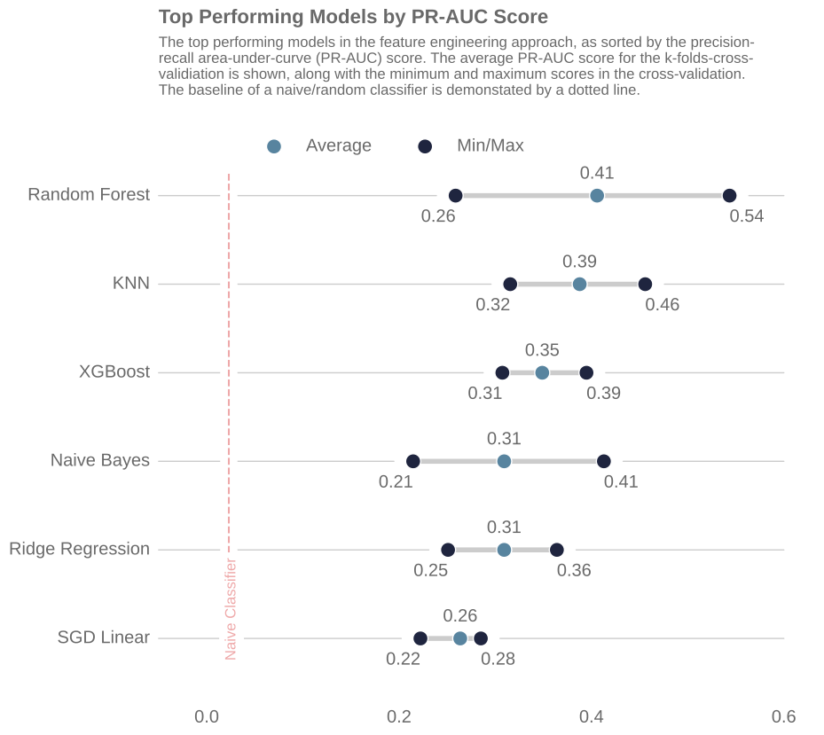
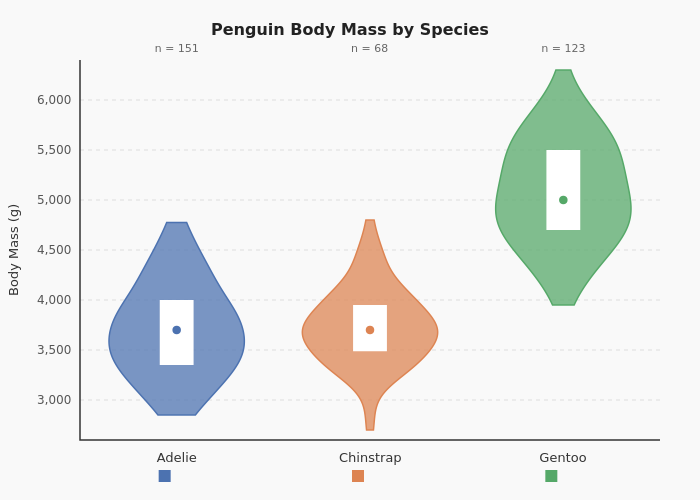
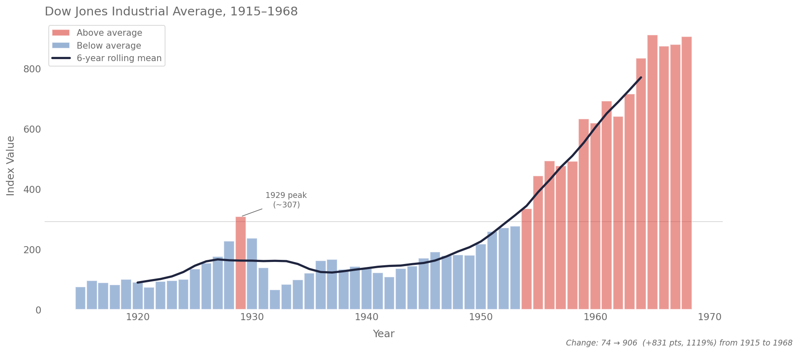

# I Taught Claude to Make Beautiful Charts. Then It Forgot How.

I've always been the person who notices when a chart looks bad. Ugly PowerPoint slides, default Excel colours, unlabeled axes. It all bothered me. During my Master's at Queen's University, I would spend hours tweaking the smallest detail in a matplotlib chart before it was ready for a publication. See the lollipop chart below for the kind of thing I mean.

Fast forward to today, and I'm using Claude Code (Anthropic's coding agent) to make data visualizations for work and personal projects. But the "default" charts that Claude Code makes with matplotlib are, well, not great. So I built an *opinionated* skill to fix that. Here's what I learned over 50 iterations, and how the optimization process I built led to an unexpected outcome.

---

## What's a Claude Code Skill?

As [Simon Willison put it](https://simonwillison.net/2025/Oct/16/claude-skills/), skills are "conceptually extremely simple: a skill is a Markdown file telling the model how to do something, optionally accompanied by extra documents and pre-written scripts."

The matplotlib skill that I've built has three main components:
- A style spec (palettes, fonts, despine rules)
- Nine pattern templates (one per chart type)
- A verification workflow

To use it, you say something like "Make a chart using the matplotlib skill". The skill will determine the chart type based on the dataset and apply the appropriate styling and patterns that I like. I made it to look like the charts as I would like them. It's opinionated, and that's the point.

Here's an example of what a chart looks like with the "vanilla" Claude Code, versus what it looks like with the matplotlib skill. Same data, same one-line prompt, but the skill's templates and style rules make it look much more polished and publication-ready.

The defaults chart:

And the improved chart with the skill:

---

## How I Built It — And What Went Wrong

Like most things I do in Claude Code, I started building the skill by asking Claude Code to build it for me. Here's the initial prompt I used while in my weibull-knowledge-informed-ml project ([github link here](https://github.com/tvhahn/weibull-knowledge-informed-ml)) to create the skill:

Initial prompt to Claude Code (click to expand)

> I spent a lot of time creating beautiful visualizations for this project (weibull knowledge informed). You can see the final outputs in the @reports/figures/ (e.g. see the @reports/figures/ims_rul_results.png , or the @reports/figures/loss_function_percentages.svg, or the @reports/figures/spectrogram_with_binned_example.png ). These were primarily created with matplotlib and seaborn.
>
> What I want your help with is to plan the creation of a skill that is to be used for creating matplotlib charts and diagrams. I want this skill to be able to implement a similar aesthetic to what I have already done in this project, as well in some of the other projects that I will reference below. This skill is to assume the persona of a Python developer who is an expert in data visualization. They are opinionated and have strong feelings about clean and readable data visualization, like I have implemented in the examples.
>
> What I want you to do in this planning process is to do a thorough examination of all these example repos that have data visualizations using Matplotlib and Seaborn that I have worked on. I want you to inspect them and then come up with some findings that we can replicate within this skill. What are some aesthetics that I always seem to implement? What are some common color palettes that we should be using? Again, this skill can be opinionated and assume a standard default template for the color palettes and templating and those sort of things. Perhaps you should assemble a bunch of subagents to do the discovery and then have them come back so that you can synthesize their analysis.
>
> I am not an expert in writing skills, and I do not necessarily know how this should be done. So that, once these skills that flawed code implements, there can be reference files that are included. Look into this as well. Would this be beneficial? Look at the official claude code docs, on skills (use the /docs ) to see what best practice is.
>
> As part of this plan, as well, I want this skill (and all it's files, as needed) to be placed in the `dotfiles` folder, here: ~/dotfiles/claude/skills/ . You can already see the `setup-react` skill in there.
>
> The other projects, to be referenced are:
> - Documents/Beautiful-Plots -- only the decision boundary chart and the lollipop chart are to be considered. The other one was done in plotly
> - Documents/arxiv-code-search -- look in the `reports` folder to see the relevant diagrams
> - Documents/ml-tool-wear

Claude Code analyzed my charts across four projects and identified the recurring aesthetics; things like despined axes, cubehelix palettes, dimgrey annotations, etc. It assembled the skill with nine chart patterns. 

The first version worked, but it wasn't consistent. It was able to nail certain patterns (like the horizontal bar charts), but for other chart types it drifted. I entered the iteration loop: run the skill, look at the output, tweak the markdown pattern file with Claude Code, and repeat.

But it was taking way too much time, and I'm lazy. My default work pattern should be having agents do more, not less.

Around this time I read Andrej Karpathy's "autoresearch" tweet — an autonomous loop that modifies code, evaluates a metric, keeps improvements, and discards regressions:

https://x.com/karpathy/status/2030371219518931079

Heck, why not do that for the matplotlib skill? 

It worked, kinda. I had to create a scoring system to evaluate the quality of the charts, and that's not as straightforward as optimizing a single metric. How do you score a chart? I ended up with a composite that measured things like style compliance (did it despine?), visual quality (did it sort bars by value?), and how well the chart adapted to its dataset (did it add annotations?). I kicked it off overnight, and the scores climbed. But when I opened the charts, they looked like they'd been made by someone who'd read every rule and understood none of them.

The charts were technically correct but lifeless. Annotations varied between runs. So did layout choices. The scoring system treated both as flaws. It rewarded consistency across parallel runs, so the system learned to ban creativity entirely.

The fix was simple. I restructured each pattern file to have a small "Signature" (the 2-4 things that define its identity) and flexible "Guidance" for everything else. The charts came alive again, and the scores still improved — just in the direction of quality and style, not uniformity. Here's what one of these new charts looks like:

 
*With the consistency rule removed, the skill was able to add annotations again. It recognized the 1929 crash and annotated it.*

Your optimization metric becomes your product's personality. Measure uniformity, you get uniform. Measure quality and adaptiveness, you get charts that actually communicate.

---

## What I'd Tell You If You're Building a Skill

1. **Start with taste.** A skill encodes your aesthetic judgment. Know what you want before you automate.
2. **Capture baselines.** You can't see improvement without a "before." I saved the skill's output at every iteration so I could see what was actually getting better and what was regressing.
3. **Test in isolation.** I ran every test in a Docker container with nothing but the skill files and a dataset — no gallery, no git history, no prior outputs. If the skill can't reproduce your aesthetic from scratch, it's not encoding your taste. It's just pattern-matching from context.
4. **Measure what matters.** Your scoring metric becomes your skill's personality. If you measure code uniformity, you get uniform code. If you measure visual quality, you get quality.
5. **Know when to stop.** 50 iterations was too many. The skill was good enough at iteration 20. The last 30 taught me about automation, not about charts.
6. **Rules are expensive.** Each constraint you add removes a degree of freedom. Keep identity items to 2–4 per pattern. Everything else is guidance, not law.

---

*The matplotlib skill is [open source on GitHub](https://github.com/tvhahn/matplotlib-skill). Contributions welcome.*
